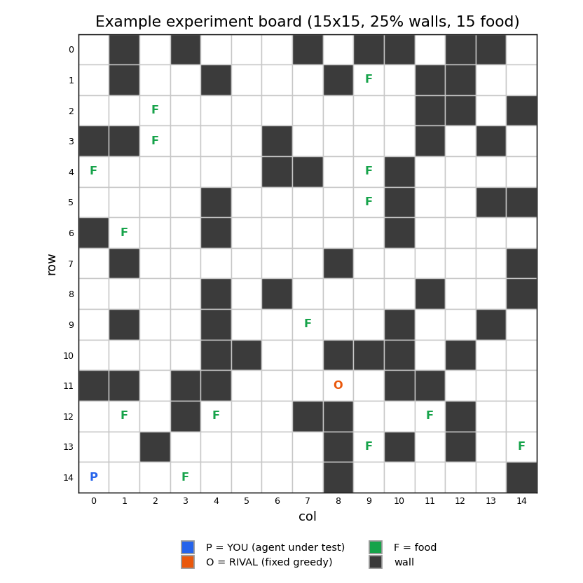
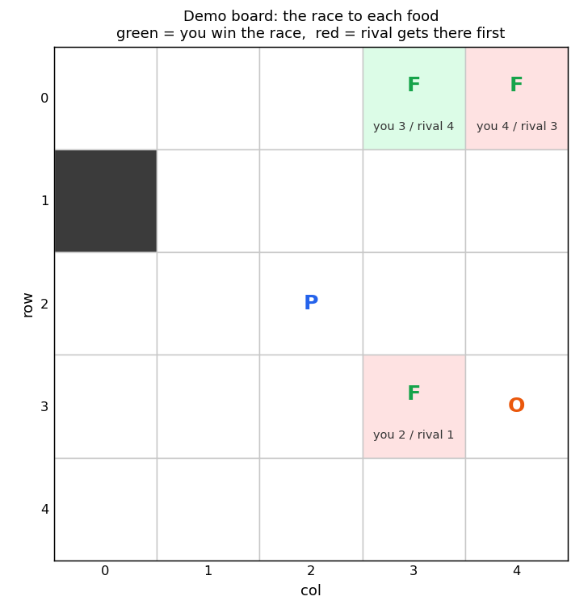
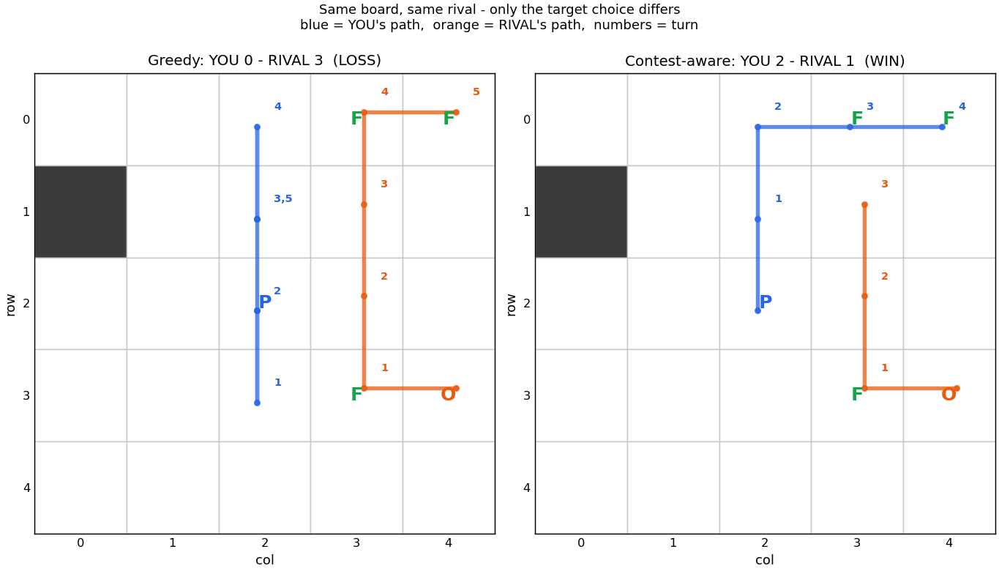
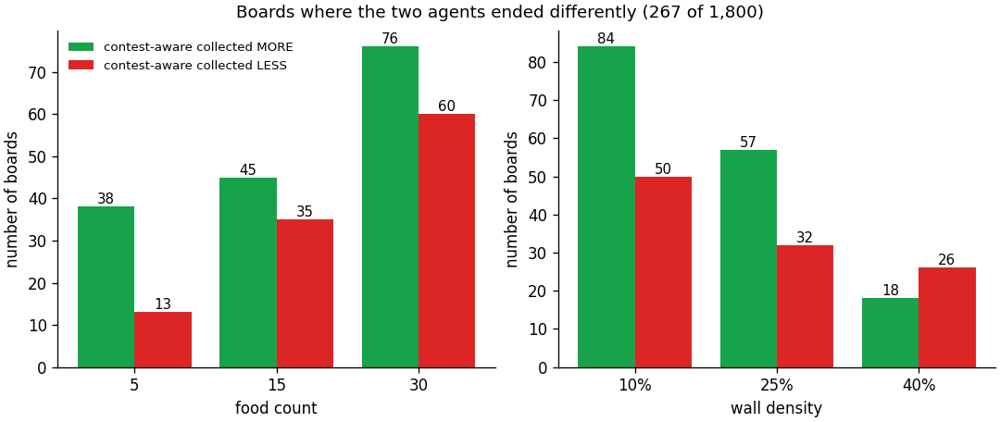

# Analysis of Algorithms — Two-Player Grid Problem

An algorithmic study of a competitive, two-player food-collection game on a grid.

## Research question
Does a **contest-aware** agent — one that targets only food it can reach *before* the
opponent — collect more food than a **greedy** agent that always heads to the nearest food?

## Why it matters
"Always go to the nearest item" is intuitive but suboptimal when a second agent competes for
the same items: you waste moves racing to food the opponent reaches first. This project tests
whether reasoning about the opponent's reach (via BFS distance comparison) beats a purely
self-centered heuristic — and whether that advantage grows as the board becomes more contested.

## The game
A 15x15 grid: empty, walls, your start, a rival start, and food. Players alternate turns
(you, then rival); each moves one cell `U/D/L/R` or stays `S`. Stepping onto food collects it.
The rival follows a fixed greedy nearest-food policy. Score = food collected.



*A real board from the experiment (25% walls, 15 food). `P` = you, `O` = rival, `F` = food.*

## Approach
- **BFS** for shortest-path distances on the grid (every move costs 1, so BFS is exact).
- **Greedy agent** (baseline): nearest reachable food.
- **Contest-aware agent**: target only food where `dist_you[f] <= dist_rival[f]` — a tie counts
  as a win because you move first. If no food is winnable, fall back to the nearest one.
- Both play identical, randomly generated, connectivity-validated boards against the same fixed
  rival (paired design). Metrics: food collected, win rate, decision time.

### The difference in one picture
On this 5x5 board the food at (3,3) is your nearest (2 steps) — but the rival is only 1 step
away. Greedy chases it anyway, loses the race, and ends up behind in every race after that:
**0–3**. Contest-aware skips it, heads for the top-row food it can win, and finishes **2–1**.
Same board, same rival; the only difference is which food each agent chose to chase.





Run `python demo.py` to watch this game move by move in the terminal.

## Layout
See [DESIGN.md](DESIGN.md) for the module design and [docs/WALKTHROUGH.md](docs/WALKTHROUGH.md)
for a guided tour of the code and a by-hand trace.

```
game.py         engine: board, BFS, moves, run_game()
agents.py       greedy + contest-aware agents, fixed rival
boards.py       random board generation + validation
experiment.py   runs all density x food combos -> results.csv
analyze.py      aggregates results -> summary, significance test, figures/
demo.py         turn-by-turn trace of the 5x5 demo board
draw_boards.py  draws the board pictures in docs/images/
tests/          correctness tests (12)
report/         the written report
```

## Run
```
pip install -r requirements.txt
python demo.py            # the hand-walkthrough game, printed turn by turn
python -m pytest          # tests
python experiment.py      # 3,600 games -> results.csv  (~2.5 minutes)
python analyze.py         # summary + significance + figures/
python draw_boards.py     # board pictures -> docs/images/
```

## Results
3 wall densities × 3 food counts × 200 boards × 2 agents = **3,600 games**.

| Agent | Win rate | Mean food | ms / move |
|---|---|---|---|
| greedy | 0.499 | 8.28 | 0.67 |
| contest-aware | 0.511 | 8.33 | 1.34 |

- **Most of the time the two strategies play the same game.** On 1,533 of 1,800 boards the
  nearest food *is* a winnable food, so both agents make identical moves.
- **When they differ, contest-aware wins more often:** better on **159** boards, worse on
  **108**. A sign test gives **p = 0.002**, and the bootstrap 95% confidence interval for the
  food gain is **[+0.009, +0.103]** — it excludes zero, so the advantage is real, not luck.
- **Where it helps:** open boards and plentiful food (more races to reason about). In tight
  mazes (40% walls) the advantage **reverses slightly** — corridors leave few real choices, and
  skipping food can cost more than it saves.
- **Cost:** two BFS per move instead of one → about **2× the time per move**, but the *same*
  big-O: `O(N² + F)` per move for both.



**Bottom line:** thinking about the opponent's reach is a cheap, statistically significant
improvement — modest on average, because it only matters on the boards where the nearest food
is one you would lose.

Course project — Analysis of Algorithms. 2026.
