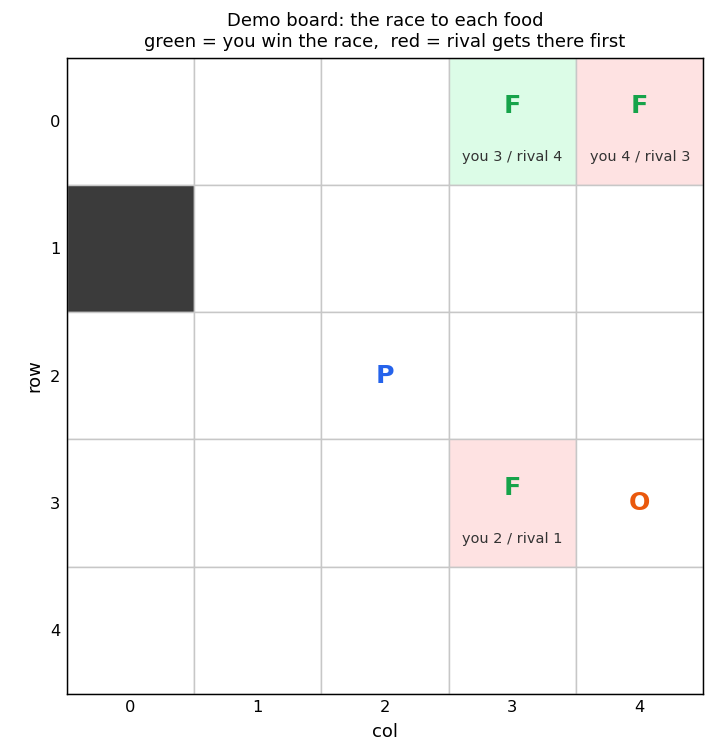
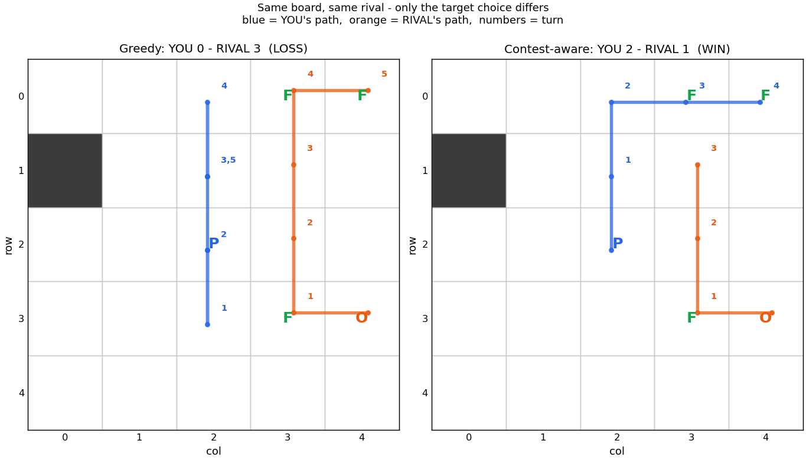
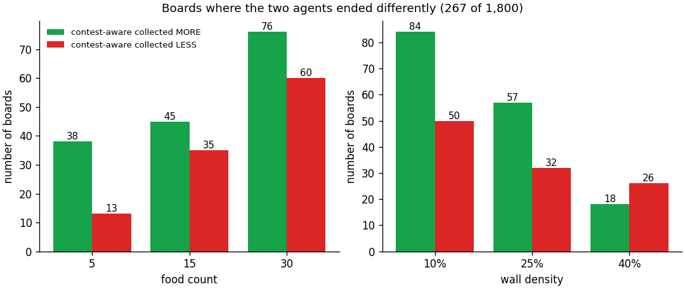

# Walkthrough — explaining the project end to end

This is your study guide for the presentation. Read it top to bottom once, then use the
**Demo script** (§8) and **Likely questions** (§9) on the day.

---

## 1. The research question in plain words

> **If two players race for the same food, is it smarter to chase the *nearest* food, or the
> nearest food you can actually *win*?**

- **Greedy** = "go to the closest food." Simple, and perfect if you're alone on the board.
- **Contest-aware** = "go to the closest food that I reach **no later than** the rival."
- We test both against the **same fixed opponent** (a greedy rival) on **the same boards**, and
  measure how much food each one collects.

**Where it came from:** a two-player grid game from an Akuna interview. The exact game isn't
published online, so we defined a clean version ourselves.

**Hypotheses**
- H0: both agents collect the same food on average.
- H1: contest-aware collects more, especially on boards with more contest (more food, open space).

---

## 2. Why we built it this way (the design choices)

| Choice | Why | One-line answer if asked |
|---|---|---|
| **BFS** for distances | Every move costs 1 step, so BFS gives exact shortest paths in `O(N²)`. | "Unweighted grid → BFS is optimal; Dijkstra would just be slower BFS." |
| **Greedy as the baseline** | It's the natural first strategy and is optimal for a single player. | "It's what anyone would try first, so it's the fair thing to beat." |
| **Contest-aware as the challenger** | Smallest change that reasons about the opponent: one extra BFS. | "I only changed *which food* to target — nothing else." |
| **Fixed greedy rival** | If the opponent changed, we couldn't tell what caused a result. | "Control variable." |
| **Paired design** (both agents, same board) | Removes "lucky map" noise. | "Each board is its own control." |
| **Connectivity check** on boards | Boards where players or food are walled off are meaningless. | "Otherwise some games are decided before move one." |
| **Seeded randomness** | Same seed → same board → reproducible results. | "Anyone can re-run and get my exact numbers." |
| **Sign test + bootstrap** | Most boards are ties; we need to show the wins aren't luck. | "p = 0.002, CI excludes zero." |
| **Python, stdlib + matplotlib** | Every line is explainable; no black-box libraries. | "I wanted to be able to explain every line." |

---

## 3. Code tour — what to open in VS Code, in this order

| # | File | What it is | What to point at |
|---|---|---|---|
| 1 | `game.py` | The rules. No strategy. | `bfs()` and the turn loop in `run_game()` |
| 2 | `agents.py` | **The two strategies — the heart of the project.** | the `winnable` list in `contest_aware_agent` |
| 3 | `demo.py` | The 5x5 hand-walkthrough, printed move by move. | run it live |
| 4 | `boards.py` | Random board generator + connectivity check. | `generate_valid_board()` |
| 5 | `experiment.py` | Runs 3,600 games, writes `results.csv`. | the paired loop (`for name, agent in AGENTS.items()`) |
| 6 | `analyze.py` | Tables, significance test, charts. | `significance()` |
| 7 | `tests/test_game.py` | 12 correctness tests. | `TestContestAwareBehaviour` |

Every file starts with a **"HOW TO READ THIS FILE"** or docstring header, and the key lines have
comments explaining *why*, not just *what*.

---

## 4. The shared piece: BFS (`game.py`)

```python
def bfs(board, start, blocked=frozenset()):
    dist = {start: 0}            # distance from start; also our "visited" set
    first_move = {start: 'S'}    # which direction to step first to get to each cell
    queue = deque([start])       # FIFO -> cells come out in order of distance
    while queue:
        cur = queue.popleft()
        for move in ORDER:                    # U, D, L, R
            nxt = cur + DELTA[move]
            if nxt in dist: continue          # already found
            if wall / off-grid / blocked: continue
            dist[nxt] = dist[cur] + 1
            first_move[nxt] = move if cur == start else first_move[cur]
            queue.append(nxt)
    return dist, first_move
```

**How to explain it:**
1. Start at my cell, distance 0.
2. Take the next cell off the queue; look at its 4 neighbours.
3. Any neighbour not seen yet, not a wall, not the other player → it's one step further. Record that.
4. Because the queue is first-in-first-out, we finish all distance-1 cells before any distance-2
   cell, so the **first time we reach a cell is the shortest path**.
5. `first_move` answers "which way do I step *right now* to get there?" — a neighbour of start
   remembers its own move; everything further away **inherits** its parent's first move.

**Why the opponent's cell is `blocked`:** you can't move onto the other player.

---

## 5. Greedy vs contest-aware — side by side (`agents.py`)

```python
def greedy_agent(state, who):
    dist, first_move = bfs(board, me, blocked={opponent})       # 1 BFS
    target = _nearest(state.foods, dist, first_move)             # nearest of ALL food
    return first_move[target]
```

```python
def contest_aware_agent(state, who):
    my_dist,  my_first = bfs(board, me,       blocked={opponent})   # BFS #1 (same as greedy)
    opp_dist, _        = bfs(board, opponent, blocked={me})         # BFS #2 (NEW)

    winnable = [food for food in state.foods
                if food in my_dist and
                   (food not in opp_dist or my_dist[food] <= opp_dist[food])]   # NEW

    pool = winnable if winnable else list(state.foods)                # NEW: fallback
    target = _nearest(pool, my_dist, my_first)                        # nearest of WINNABLE food
    return my_first[target]
```

### The difference, in three bullets
1. **One extra BFS** — from the opponent's position, to learn how far *they* are from each food.
2. **A filter** — keep only food where `my_dist <= opp_dist`. That's "I get there first or at the same time."
3. **A fallback** — if I'm losing every race, still go for the nearest food instead of standing still.

Everything else (BFS, picking the nearest, taking the first step) is **identical**.

### Why `<=` and not `<`?
It's *my* turn when I decide. If we're both 3 steps away, I move first, so after my 3rd step
I'm on the food before the rival's 3rd step. **A tie is a win for the player about to move.**

### Why the fallback?
Without it, an agent losing every race would return `'S'` and stand still forever. Going for
the nearest food anyway keeps pressure on — the rival might pick a different target and leave it.

---

## 6. The by-hand walkthrough (`python demo.py`)



```
       col: 0 1 2 3 4
    row 0   . . . F F        P = YOU at (2,2)
    row 1   # . . . .        O = RIVAL at (3,4)
    row 2   . . P . .        F = food at (0,3), (0,4), (3,3)
    row 3   . . . F O        # = wall at (1,0)
    row 4   . . . . .
```

### Step 1 — BFS distances by hand (do this on the whiteboard)

From **YOU** at (2,2) (rival's cell blocked):
```
    4 3 2 3 4
    # 2 1 2 3
    2 1 0 1 2
    3 2 1 2 O
    4 3 2 3 4
```
From **RIVAL** at (3,4) (your cell blocked):
```
    7 6 5 4 3
    # 5 4 3 2
    5 4 P 2 1
    4 3 2 1 0
    5 4 3 2 1
```
Tip for the board: just count Manhattan steps outward from the start, ring by ring — that *is*
what BFS does. Note the rival's numbers on the left side are larger than Manhattan distance
because **your cell blocks** the straight path through the middle.

### Step 2 — the race table at the start

| Food | You | Rival | Race |
|---|---|---|---|
| (3,3) | **2** | 1 | LOSE — rival is closer |
| (0,3) | 3 | 4 | **WIN** |
| (0,4) | 4 | 3 | LOSE |

- **Greedy** looks only at the "You" column → nearest is (3,3) at 2 → steps **D** toward it.
- **Contest-aware** keeps only the WIN rows → only (0,3) → steps **U** toward it.

That one decision is the whole difference. Now watch what it costs.

### Step 3 — the greedy game (final 0–3, LOSS)

| Turn | YOU | RIVAL | What happened |
|---|---|---|---|
| 1 | D → (3,2) | L → (3,3), **eats it** | Rival was 1 step away; you arrive one turn too late. |
| 2 | U → (2,2) | U → (2,3) | Now both top foods: you 4 & 5, rival 3 & 4. You're behind on both. |
| 3 | U → (1,2) | U → (1,3) | Rival shadows you one column to the right, still one step ahead. |
| 4 | U → (0,2) | U → (0,3), **eats it** | Rival 2. |
| 5 | D (heads around the rival) | R → (0,4), **eats it** | Rival 3. Game over. |

Greedy's first move wasted two turns (down then back up), and that tempo loss made it lose
**every** remaining race.

### Step 4 — the contest-aware game (final 2–1, WIN)

| Turn | YOU | RIVAL | What happened |
|---|---|---|---|
| 1 | U → (1,2) | L → (3,3), **eats it** | You let the rival have the food you couldn't win. Rival 1. |
| 2 | U → (0,2) | U → (2,3) | Race table: (0,3) you 1 vs 2, (0,4) you 2 vs 3 — **both now winnable**. |
| 3 | R → (0,3), **eat** | U → (1,3) | You 1. |
| 4 | R → (0,4), **eat** | — | You 2. Game over. |

**The key insight to say out loud:** food (0,4) started as a **lost** race (4 vs 3). But the
rival spent turns going *down* to eat (3,3), so by turn 2 the race had **flipped** to a win.
Contest-aware recomputes the race table **every turn**, so it noticed.



This board is locked in by a test (`test_demo_board_outcomes`), and it was picked so that no
two foods are ever tied in distance — every move above is explained by distances alone.

---

## 7. Results — what to say about the big experiment

**Setup:** 3 wall densities (10/25/40%) × 3 food counts (5/15/30) × 200 boards × 2 agents =
**3,600 games**, every board played by both agents.

| | greedy | contest-aware |
|---|---|---|
| Win rate | 0.499 | 0.511 |
| Mean food | 8.28 | 8.33 |
| ms per move | 0.67 | 1.34 |

**How to explain the small average gap — this is the most important slide:**
- On **1,533 of 1,800** boards both agents played *exactly the same game*. That happens whenever
  the nearest food is also a food you can win — then both agents pick the same target.
- On the **267** boards where they differed: contest-aware better on **159**, worse on **108**.
- **Sign test:** if the two were equally good, each of those 267 would be a coin flip. Getting
  159+ heads is very unlikely by chance → **p = 0.002**.
- **Bootstrap 95% CI** for food gained per game: **[+0.009, +0.103]**. Doesn't include 0.
- **So:** the advantage is real but only shows up when there's an actual race to reason about.



**Where it helps and where it doesn't:**
- Helps most on **open boards** (10% walls: 84 better vs 50 worse).
- **Reverses in tight mazes** (40% walls: 18 better vs 26 worse). Corridors leave few
  alternatives, and skipping a contested food can mean walking a long way around for nothing.

**Cost (complexity):**
- BFS: `O(N²)` (visit each of the N² cells once, 4 neighbours each).
- Greedy per move: 1 BFS + scan F foods = `O(N² + F)`.
- Contest-aware per move: 2 BFS + scan = `O(2N² + F)` = **still `O(N² + F)`** — same order, ~2× constant.
- Measured: 0.67 → 1.34 ms/move. Exactly the 2× the analysis predicts.
- Per game: `O(T · (N² + F))` for both, where T = number of turns.

---

## 8. Demo script (≈5 minutes)

Open the folder in VS Code, open a terminal, then:

1. **Say the question** (§1) — 20 seconds.
2. **Show the board picture** — open `README.md` preview (Ctrl+Shift+V).
3. **Open `agents.py`** — scroll greedy, then contest-aware. Point at the second `bfs` call and
   the `winnable` list: "this is the only difference."
4. **Run the walkthrough:**
   ```bash
   python demo.py
   ```
   Scroll to the first race table: "(3,3) is nearest but I lose it 2 vs 1." Show greedy loses
   0–3, contest-aware wins 2–1.
5. **Run the tests:**
   ```bash
   python -m pytest
   ```
   "12 tests — BFS distances, walls, collision rules, termination, and the agents' behaviour."
6. **Show results:** run `python analyze.py` (uses the saved `results.csv`, so it's instant) and
   point at the Significance block. Then show `decisive_boards.png`.
7. **Close with the takeaway:** "Reasoning about the opponent costs one extra BFS — same big-O —
   and gives a small but statistically significant gain, concentrated on open boards."

> If `results.csv` is missing, `python experiment.py` regenerates it (~2.5 minutes — start it
> before you present, not during). For a ~30-second live run, set `N_BOARDS = 40` at the top of
> `experiment.py` first (numbers will differ slightly from the report).

---

## 9. Likely questions — and short answers

**Q: Why BFS and not Dijkstra or A\*?**
Every step costs 1. BFS on an unweighted graph gives shortest paths directly in `O(V+E)`;
Dijkstra adds a priority queue for no benefit. A* would help for one target, but we need
distances to *every* food, so a full BFS is the right tool.

**Q: Why does a tie count as a win?**
It's my turn when I decide. Equal distance means I take my last step first.

**Q: If contest-aware is smarter, why is the average gain so small?**
On 85% of boards the nearest food *is* winnable, so both agents do the same thing. The gain only
exists where they differ — and there it's significant (159 vs 108, p = 0.002).

**Q: Why is it worse in dense mazes?**
Narrow corridors mean skipping a food often forces a long detour, and the rival's path and yours
overlap so much that the distance comparison is less informative. It's a real limitation, and we
report it.

**Q: Isn't contest-aware twice as slow?**
Twice the constant (two BFS instead of one), same asymptotic order `O(N² + F)` per move. At
1.34 ms per move, it's irrelevant in practice.

**Q: Is the rival's distance really accurate? The rival also moves.**
It's the rival's distance *right now*. We recompute every turn, so if the rival changes course,
the race table updates (that's exactly what happens to food (0,4) in the demo).

**Q: What are the limitations?**
One fixed, known, greedy rival; one board size (15×15); it's a one-step-at-a-time heuristic, not
a game-tree search. A smarter rival might punish contest-aware differently.

**Q: What would you do next?**
Test against a contest-aware rival (mirror match), add 1-ply lookahead / minimax, or vary board size.

**Q: How do you know the code is correct?**
12 unit tests: BFS distances (incl. a wall detour worked out by hand), illegal moves, collection,
termination and stalemate, a crafted board where the agents must diverge, board connectivity,
and the demo board's exact outcome. Plus every run is seeded, so results are reproducible.

---

## 10. One-paragraph summary (memorise this)

> I compared two strategies for a two-player food race on a grid. Greedy always heads for the
> nearest food; contest-aware runs a second BFS from the opponent and only chases food it can
> reach first. Across 3,600 paired games, both agents play identically on most boards, but where
> they differ contest-aware wins 159 to 108 — statistically significant at p = 0.002. The gain is
> biggest on open boards and reverses slightly in dense mazes. It costs one extra BFS per move:
> twice the constant, same `O(N² + F)` complexity.
