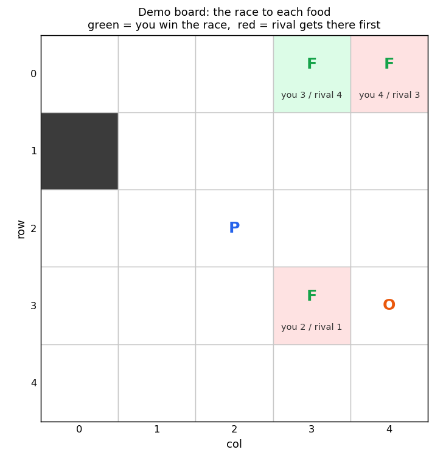
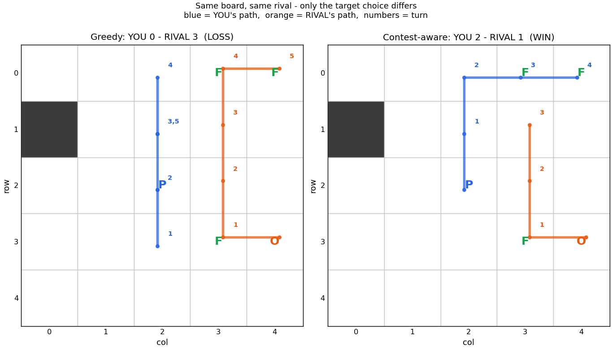

# Chase the Nearest, or Chase What You Can Win?
### A heuristic comparison in a two-player competitive grid-foraging game

**Course:** Analysis of Algorithms · **Author:** Jerome _[last name]_ · **Date:** November 2026

> HOW TO USE THIS SCAFFOLD: the structure, pseudocode, numbers, and figures are filled in
> from the actual implementation and experiment. Wherever you see a `> IN YOUR WORDS:` prompt,
> replace it with your own explanation — the grading rubric rewards *you* being able to explain
> the design and findings, so those paragraphs should sound like you. Delete these quote-blocks
> before submitting.

---

## 1. Research question and motivation  *(rubric: 35 pts)*

**Question.** In a two-player food-collection game on a grid, does a *contest-aware* agent — one
that targets only food it can reach **before** the opponent — collect more food than a *greedy*
agent that always heads to the nearest food?

**Why it matters.** "Go to the nearest item" is the instinctive strategy, and for a single agent
on a grid it is optimal. But when a second agent competes for the same items, nearest-first can
waste moves: you march toward food the opponent reaches first and arrive to nothing. This project
asks whether a small amount of reasoning about the *opponent's* reach — one extra shortest-path
computation per turn — converts into more food, and under what board conditions the benefit
appears or disappears.

> IN YOUR WORDS: add 2-3 sentences on why this caught your interest (it came from an Akuna
> interview problem) and what you expected to find before running it.

**Hypotheses.**
- H0 (null): the two agents collect the same amount of food on average.
- H1 (alternative): contest-aware collects more, and its advantage grows as the board becomes
  more *contested* (more food, more open space where races actually happen).

---

## 2. Problem formulation and algorithm design  *(rubric: 20 pts)*

### 2.1 The game
A 15×15 grid. Each cell is empty, a wall, your start `P`, the rival start `O`, or food `F`.
Players alternate turns, **YOU first then RIVAL**. On a turn a player makes one move in
`{U, D, L, R, S}` (S = stay). A move is illegal if it leaves the grid, enters a wall, or lands on
the other player's cell. Stepping onto food collects it (removed from the board). A player's score
is the food it has collected. The game ends when no food remains, when neither player can reach
any remaining food, or at a 400-turn safety cap.

The **rival is fixed** across all experiments: it plays the greedy nearest-food policy. Holding
the opponent constant is what makes the two agents directly comparable.

### 2.2 Shortest paths: BFS
Because every move costs one step, shortest paths on the grid are found by breadth-first search.
Each BFS returns, for every reachable cell, its distance from the source and the first move to
head toward it. The opponent's current cell is passed as a blocked cell.

```
BFS(board, start, blocked):
    dist[start] = 0;  first_move[start] = 'S';  queue = [start]
    while queue not empty:
        cur = queue.pop_front()
        for move in [U, D, L, R]:                 # fixed order -> deterministic tie-break
            nxt = cur + delta(move)
            if nxt already seen: continue
            if nxt is wall / off-grid / in blocked: continue
            dist[nxt] = dist[cur] + 1
            first_move[nxt] = move if cur == start else first_move[cur]
            queue.push_back(nxt)
    return dist, first_move
```

### 2.3 The two agents (the independent variable)
Only the choice of which food to chase differs; movement and collection are identical.

```
GREEDY(state, me):
    dist, first = BFS(board, pos[me], blocked = {pos[opponent]})
    target = nearest reachable food by (dist, tie-break order)
    return first[target]  (or 'S' if none reachable)
```

```
CONTEST_AWARE(state, me):
    my_dist,  my_first = BFS(board, pos[me],       blocked = {pos[opponent]})
    opp_dist, _        = BFS(board, pos[opponent], blocked = {pos[me]})
    winnable = { f in foods : f in my_dist and
                 (f not reachable by opponent or my_dist[f] <= opp_dist[f]) }
        # a tie counts as a win because on your turn you move first
    pool = winnable if winnable is non-empty else all foods
    target = nearest food in pool by (my_dist, tie-break order)
    return my_first[target]  (or 'S' if none reachable)
```

> IN YOUR WORDS: explain the one key idea in plain language — comparing `my_dist[f]` to
> `opp_dist[f]` to decide whether a food is worth chasing — and why the tie goes to you.

### 2.4 Worked example
On the 5×5 board below, food (3,3) is your nearest (2 steps) but the rival is 1 step away.
Greedy chases it, arrives a turn late, and loses every later race: **0–3**. Contest-aware sees
the lost race, heads for (0,3) instead (3 vs 4), and — because the rival detoured to (3,3) —
finds (0,4) has flipped from a lost race to a won one: **2–1**. Same board, same rival.




### 2.5 Assumptions
- Deterministic, known rival policy (so no opponent modelling is needed).
- Both players have full knowledge of the board each turn.
- The 90%-connectivity board filter (see §4) keeps games meaningful.

---

## 3. Complexity analysis  *(rubric: 10 pts)*

Let `N = 15` (grid side), so the grid has `N² = 225` cells; let `T` be the number of turns in a
game and `F` the number of foods.

- **BFS:** visits each cell once and checks four neighbours → `O(N²)`. For `N = 15` this is a
  constant ≈ 225 operations.
- **Greedy agent:** one BFS per turn, then an `O(F)` scan for the nearest food →
  `O(N² + F)` per turn → `O(T · (N² + F))` per game.
- **Contest-aware agent:** *two* BFS per turn (yours and the opponent's) plus the `O(F)` scan →
  still `O(N² + F)` per turn, i.e. the **same asymptotic order** as greedy, with roughly double
  the constant. The extra reasoning is "free" in big-O terms.

> IN YOUR WORDS: state the takeaway — contest-aware costs ~2× the constant but not a higher
> order — and connect it to the measured ms/move in §5 (≈0.67 ms greedy vs ≈1.34 ms contest).

---

## 4. Method: experimental design  *(rubric supports 15 pts testing)*

- **Board generation (`boards.py`).** Random walls at density `d ∈ {0.10, 0.25, 0.40}`; food
  count `k ∈ {5, 15, 30}`; random distinct start cells. A board is **accepted only if** the rival
  and ≥90% of the food lie in the same connected open region as the player (flood fill from `P`).
  Seeds are fixed, so every run is reproducible.
- **Paired design (`experiment.py`).** For each `(d, k)` combination we generate **200** valid
  boards. Each board is played **twice on the identical map** — once by greedy, once by
  contest-aware — against the same fixed greedy rival. Because both agents face the exact same
  board, differences cannot be explained by luck of the map.
- **Scale.** 3 densities × 3 food counts × 200 boards × 2 agents = **3,600 games**.
- **Metrics.** Food collected, win/tie/loss vs the rival, and average decision time per move.
- **Significance (`analyze.py`).** On the paired boards where the agents diverge, a two-sided
  **sign test** checks whether contest-aware wins more often than a coin flip; a **bootstrap**
  (2,000 resamples) gives a 95% confidence interval for the mean food difference.

---

## 5. Results and findings  *(rubric: 15 pts)*

### 5.1 Overall (all 3,600 games)

| Agent | Win rate | Mean food | Mean food-share | ms / move |
|---|---|---|---|---|
| greedy | 0.499 | 8.28 | 0.508 | 0.665 |
| contest_aware | 0.511 | 8.33 | 0.513 | 1.338 |

**Paired comparison (1,800 identical boards):** contest-aware collected more food on **159**
boards, fewer on **108**, and tied on **1,533**; mean food difference **+0.055** per game.

**Significance.** The two strategies play out identically on most boards, so the real test is the
**267 "decisive" boards where they diverge**. There contest-aware wins 159 and loses 108 — a
**two-sided sign test gives z = 3.06, p = 0.002**, so the advantage is not chance. A bootstrap
(2,000 resamples) puts the **95% confidence interval for the mean food gain at [+0.009, +0.103]**,
which excludes zero. Both tests reject H0 at α = 0.05: contest-aware is genuinely, if modestly,
better.

### 5.2 Where the advantage comes from

Win-rate advantage of contest-aware over greedy, by condition:

| Food count `k` | Δ win rate | Δ mean food |
|---|---|---|
| 5 | +0.013 | +0.043 |
| 15 | −0.002 | +0.035 |
| 30 | **+0.023** | **+0.087** |

| Wall density `d` | Δ win rate |
|---|---|
| 0.10 | **+0.028** |
| 0.25 | +0.020 |
| 0.40 | −0.013 |

Figures (regenerate with `python analyze.py`):
- `figures/winrate_by_food.png` — win rate vs food count.
- `figures/winrate_by_density.png` — win rate vs wall density.
- `figures/decision_time.png` — decision-time distributions.

### 5.3 Interpretation

The data **supports H1**: contest-aware is better on average, and on the boards where the
strategies diverge the advantage is **statistically significant** (sign test p = 0.002; bootstrap
CI excludes zero). The effect is **small in aggregate** because on most boards the two strategies
pick the same food, so the game plays out identically (1,533 of 1,800 ties) — the strategies only
*can* differ when the nearest food and the nearest *winnable* food are not the same cell. When
they do differ, reasoning about the opponent's reach pays off. The advantage is **largest where
contest is highest** — the most food (`k = 30`) and the most open boards (`d = 0.10`–`0.25`) — and
**reverses slightly in dense mazes** (`d = 0.40`), where narrow corridors force both agents into
the same moves and leave little to reason about.

> IN YOUR WORDS: write the headline conclusion as you would say it out loud: reasoning about the
> opponent's reach is a cheap, net-positive tweak that pays off most when the board is open and
> food is plentiful, and is not worth much in tight mazes. Note anything that surprised you (e.g.
> the k=15 dip).

---

## 6. Conclusion

> IN YOUR WORDS (one short paragraph): restate the question, give the answer the data supports,
> name the main limitation (a single fixed greedy opponent; a known deterministic rival), and
> suggest one extension (e.g. a 1-ply lookahead agent, or a smarter rival).

---

## 7. Reproducibility

- Tests: `python -m pytest` → 12 passing (BFS distances, wall detours, legal moves, collection,
  termination, stalemate, a crafted board where contest-aware provably diverges from greedy,
  the demo board's exact 0–3 vs 2–1 outcome, board connectivity, and random-board games).
- Worked example: `python demo.py` prints the 5×5 demo game move by move (see §2.4).
- Full pipeline: `python experiment.py` then `python analyze.py`.
- Code: engine `game.py`, strategies `agents.py`, boards `boards.py`, runner `experiment.py`,
  analysis `analyze.py`.
